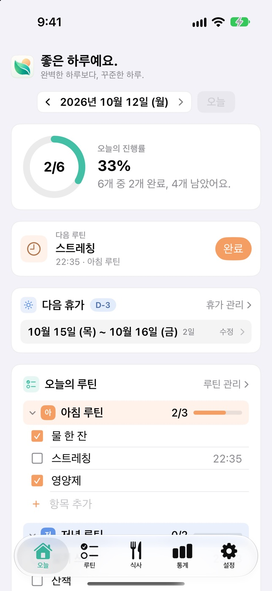
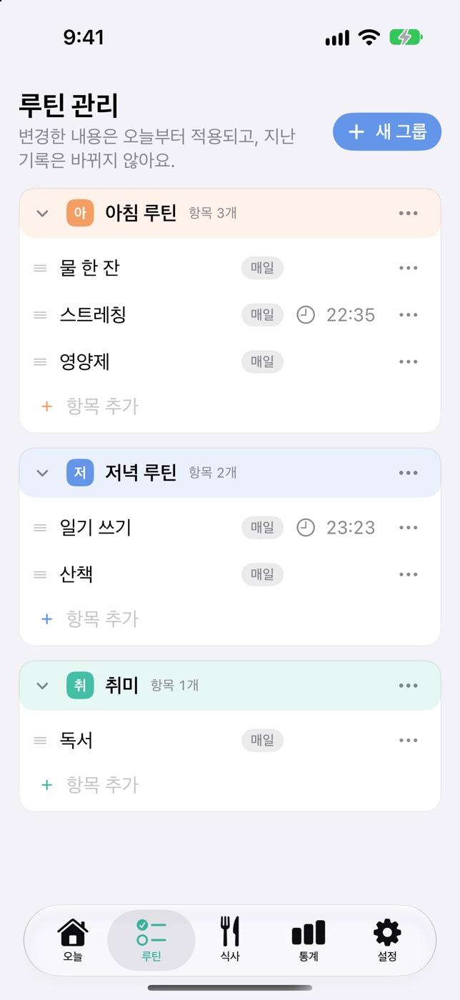
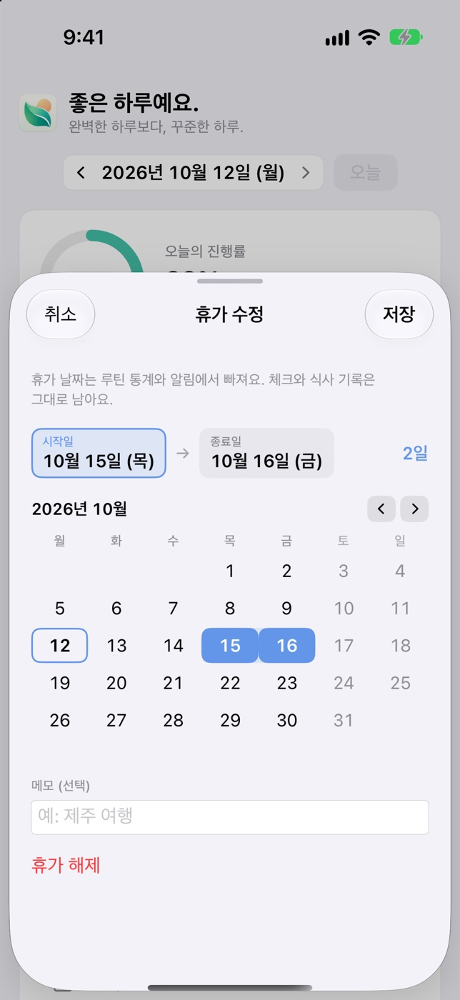

<p align="center">
  
</p>

<h1 align="center">Daylog</h1>

<p align="center">
  <b>하루를 기록하다.</b><br>
  루틴을 체크하고 식사를 적는, 가볍고 예쁜 앱<br>
  <sub>Mac · iPhone · iPad</sub>
</p>

<p align="center">
  <a href="https://github.com/gyu-bin/Daylog/releases/latest"></a>
  
  
  
</p>

<p align="center">
  <a href="https://github.com/gyu-bin/Daylog/releases/latest"><b>⬇️ Mac용 내려받기</b></a>
</p>

<p align="center">
  
  
</p>

<br>

## ✨ 이런 걸 할 수 있어요

<table>
  <tr><td nowrap>✅ <b>오늘의 루틴</b></td><td>아침 루틴, 운동처럼 그룹으로 묶어 하나씩 체크해요. 요일과 예정 시간도 정할 수 있어요.</td></tr>
  <tr><td nowrap>🍚 <b>식사 기록</b></td><td>아침·점심·저녁·간식을 자유롭게 적어요. 저장 버튼 없이 알아서 저장돼요.</td></tr>
  <tr><td nowrap>📅 <b>캘린더</b></td><td>날짜를 누르면 그날의 루틴과 식사를 보고 고칠 수 있어요.</td></tr>
  <tr><td nowrap>📈 <b>통계</b></td><td>달성률 추이, 연속 달성일, 활동 히트맵, 지난 기간과의 비교까지.</td></tr>
  <tr><td nowrap>🧩 <b>내 맘대로 대시보드</b></td><td>카드를 끌어서 두 열에 배치하고, 안 쓰는 카드는 숨겨요.</td></tr>
  <tr><td nowrap>🧭 <b>메뉴 막대 · 위젯</b></td><td>Mac은 메뉴 막대에서, iPhone·iPad는 홈 화면 위젯에서 앱을 열지 않고 체크해요.</td></tr>
  <tr><td nowrap>🔔 <b>루틴 알림</b></td><td>정해 둔 시간에 알려 주고, 알림에서 바로 <b>완료</b>를 누를 수 있어요.</td></tr>
  <tr><td nowrap>🏖 <b>휴가 모드</b></td><td>달력에서 기간을 골라 두면 그날은 통계에서 빠지고, 연속 달성 기록은 그대로 이어져요. 휴가 동안 모두 쉴지, 고른 루틴만 이어 갈지도 정할 수 있어요.</td></tr>
  <tr><td nowrap>📦 <b>가져오기 · 내보내기</b></td><td>기록을 CSV·JSON 파일로 내보내고, 루틴을 파일에서 가져와요.</td></tr>
  <tr><td nowrap>☁️ <b>iCloud 동기화</b></td><td>같은 Apple 계정의 Mac·iPhone·iPad가 기록을 맞춰요.</td></tr>
</table>

<br>

<p align="center">
  
  
  
</p>

<p align="center">
  
  
  
</p>

<p align="center"><sub>스크린샷 속 내용은 예시 데이터예요.</sub></p>

<br>

## 📥 설치하기

**Mac**

1. [**최신 버전**](https://github.com/gyu-bin/Daylog/releases/latest)에서 `Daylog-…-macOS.dmg`를 받아요.
2. 열어서 **Daylog**를 **Applications** 폴더로 끌어다 놓아요.
3. Daylog를 실행해요. 처음엔 "인터넷에서 받은 앱"이라는 안내가 나오는데, **열기**를 누르면 돼요.

macOS 14 이상이면 되고, 다른 프로그램은 필요 없어요. **업데이트**할 때는 Daylog를 끄고, 새 버전을 받아 같은 방법으로 덮어쓰면 돼요. 기록은 그대로 남아요.

**iPhone · iPad**

지금은 TestFlight로 테스트하고 있어요. App Store 공개는 준비 중이에요. iOS·iPadOS 17 이상에서 동작해요.

<br>

## 🙋 자주 묻는 것

**기록은 어디에 저장되나요?**<br>
내 Mac에 저장되고, iCloud를 쓰면 내 iCloud에만 올라가요. 따로 가입하는 계정도, 정보를 모으는 서버도 없어요.

**루틴을 지우면 예전 기록도 사라지나요?**<br>
아니요. 지난 날짜의 기록과 통계는 그대로 남아요.

**다른 기기에서도 같은 기록을 보고 싶어요.**<br>
같은 Apple 계정으로 iCloud에 로그인하면 돼요. Mac은 위의 DMG로 설치한 앱이어야 해요. 연결 상태는 설정에서 볼 수 있어요.

**알림이 안 와요.**<br>
설정에서 **루틴 알림**을 켜고, 루틴 편집에서 **예정 시간**을 정해 주세요. 알림은 Mac마다 따로 켜요.

**창을 닫았는데 앱이 계속 켜져 있어요.**<br>
메뉴 막대에서 바로 체크할 수 있게 남아 있는 거예요. 끄려면 메뉴 막대 아이콘에서 **Daylog 종료**를 누르고, 아이콘이 필요 없으면 설정의 **메뉴 막대에 Daylog 표시**를 꺼 주세요.

**달력을 일요일부터 보고 싶어요.**<br>
설정의 **캘린더 → 한 주의 시작**에서 바꿀 수 있어요. 기기마다 따로 정해요.

**iPhone이나 iPad에서도 쓸 수 있나요?**<br>
네, 같은 기능의 앱이 있어요. 지금은 TestFlight 테스트 단계라 App Store에는 아직 없어요.

<br>

## 🛠 개발자라면

<details>
<summary>소스에서 빌드하기, 배포하기, 구조 보기</summary>

<br>

SwiftUI · SwiftData · Swift Charts · CloudKit으로 만들었어요. Xcode가 필요해요.

**빌드해서 설치**

```bash
git clone https://github.com/gyu-bin/Daylog.git
cd Daylog
Tools/install.sh
```

**테스트**

```bash
xcodebuild -project Daylog.xcodeproj -scheme Daylog -derivedDataPath build -allowProvisioningUpdates test
```

**iPhone · iPad 앱 빌드** (시뮬레이터)

```bash
xcodebuild -project Daylog.xcodeproj -scheme DaylogiOS -derivedDataPath build-ios \
  -destination 'platform=iOS Simulator,name=iPhone 17 Pro' build
```

TestFlight에 올리는 명령은 [진행 상태](docs/PROGRESS.md)의 "TestFlight 준비"에 있어요.

**내 Mac의 앱 바꾸기 + GitHub의 DMG 맞추기**

```bash
Tools/update.sh               # 내 Mac의 앱을 바로 바꾸고(공증 없이), 이어서 공증한 DMG를 GitHub Release에 올리기
Tools/update.sh --no-publish  # 내 Mac의 앱만 바꾸기
```

커밋·push하지 않은 변경이 있거나 앱 소스가 그대로면 올리지 않아요. 이미 게시한 버전은 바꾸지 않으니, 앱을 고쳤으면 먼저 버전을 올려요.

**배포판(DMG)만 만들기**

```bash
Tools/release.sh            # 테스트 → 서명 → 공증 → DMG → 검증
Tools/release.sh --publish  # 위와 같이 만든 뒤 GitHub Release에 올리기
```

**앱 안의 업데이트(Sparkle)** — 1.5.2부터 켜져 있어요. 새 버전은 버전을 올려서 배포해요(같은 버전을 다시 올리지 않아요). 서명 키와 절차는 [업데이트 운영](docs/UPDATES.md)에 있어요.

```bash
Tools/bump-version.sh 1.5.3   # Mac 버전·빌드 번호 올리기 + 릴리스 노트 틀(docs/releases)
Tools/update.sh               # 내 Mac 교체 → 공증 → DMG + appcast 게시
Tools/update-test.sh prepare  # 실제 앱과 분리된 업데이트 설치 시험 준비
```

**알아 둘 점**

- 내려받은 앱(DMG)과 Xcode로 빌드한 앱은 서로 다른 iCloud 환경(Production / Development)을 써서 둘 사이에는 동기화되지 않아요. 어느 쪽인지는 설정의 **iCloud 환경**에 나와요.
- 한 Mac에서 설치 방법을 바꿨다면, 앱을 끄고 아래를 한 번 실행하면 기존 기록을 새 환경에 다시 올려요(백업을 먼저 만들어요).

  ```bash
  open -n /Applications/Daylog.app --args -DaylogReuploadAll YES
  ```

- DMG 안의 앱은 Apple 공증을 받았지만, DMG 파일 자체는 서명되지 않았어요.
- 서명 설정은 만든 사람의 Apple 계정에 맞춰져 있어요. 다른 계정으로 빌드하려면 Xcode의 Signing & Capabilities에서 Team과 Bundle Identifier를 바꾸세요.
- iPhone·iPad 앱은 TestFlight로 실제 기기 테스트를 시작한 단계예요. 아직 확인하지 못한 항목은 [진행 상태](docs/PROGRESS.md)에 적어 두었어요.

**폴더 구조**

```
Daylog/           macOS 앱과 iPhone·iPad 앱이 함께 쓰는 코드
├── App/          앱 시작, 화면이 읽는 상태, 플랫폼별 차이
├── Models/       저장 모델, 백업, 형식 변환
├── Services/     기록·루틴·통계·동기화 규칙
├── Views/        화면
├── Components/   공통 부품
└── Theme/        색과 외관
DaylogShared/     앱과 위젯이 함께 쓰는 코드
DaylogWidgets/    iPhone·iPad 홈 화면 위젯
DaylogTests/      테스트
Tools/            설치·배포 스크립트
```

**문서**

- [설계 결정과 그 이유](ARCHITECTURE.md)
- [진행 상태와 다음 작업](docs/PROGRESS.md)
- [제품 UX 점검](docs/PRODUCT_UX_AUDIT.md) · [디자인 정리](docs/DESIGN_REFINEMENT.md)
- [개발 로드맵](docs/DEVELOPMENT_PLAN.md)
- [자동 업데이트 켜는 절차](docs/UPDATES.md)

</details>

<br>

## 📝 버전 기록

**iPhone · iPad**

| 버전 | 달라진 점 |
|---|---|
| **1.0.0** | 첫 버전(TestFlight). Mac과 같은 기록·통계, 홈 화면 위젯, 루틴 알림 |

**Mac**

| 버전 | 달라진 점 |
|---|---|
| **1.5.2** | 앱 안의 업데이트(설정 → 정보 → 업데이트 확인), 휴가 중 루틴(전체 휴식 / 선택한 루틴만 유지) |
| 1.5.1 | 휴가 기간 달력과 휴가 카드(D-day·휴가 중), 캘린더 시작 요일, 시트·설정 화면 정리, 메뉴 막대 아이콘 새 디자인 |
| 1.5.0 | 두 열 대시보드와 카드 편집, 메뉴 막대 빠른 체크, 루틴 알림, 휴가 모드, 가져오기·내보내기, 기간 비교 통계 |
| 1.4.0 | 루틴 관리와 편집 화면 새 단장, 식사 기록·캘린더 메뉴 |
| 1.3.5 | iCloud 환경을 옮길 때 기록을 다시 올리는 기능 |
| 1.3.4 | 오늘의 루틴 화면을 더 단순하게, 첫 DMG 배포 |
| 1.3.3 | 새 앱 아이콘과 사이드바 |
| 1.3.2 | 체크 해제가 안 되던 문제 수정, 라이트/다크 선택 |
| 1.3.1 | 루틴 관리 새 단장, 삭제 기능, 기간별 통계와 활동 달력 |
| 1.3 | 루틴 그룹, 컬러풀한 디자인, 지난 식사 보기 |
| 1.2 | iCloud 동기화 |
| 1.1 | 첫 버전 |
