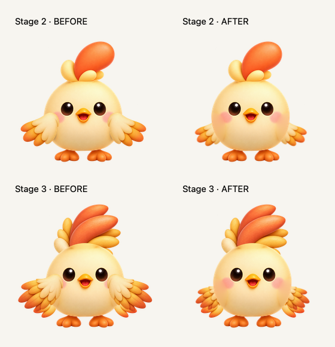

# Pio Stage 3 and shared wing attachment

Approved on 2026-10-15 after static and runtime QA. Stage 3 adds the approved crest, two tails and previously approved wings. Stages 2 and 3 share lower torso shoulders with the wing roots behind the body. Original face, body, feet, Stage 1 and existing animation tracks are preserved.



## Placement

`PioTrial.wingAttachment(stage:)` maps the unchanged source roots to shoulders `(480,995)` and `(1056,995)` on the 1536 canvas. Stage 2 uses scale 0.78; Stage 3 uses 0.72. Static attachment mounts contain the existing sway/action layers. Perspective scaling is anchored at the source root, so full 48° flaps and 62° greetings retain the attachment. Obsolete front-contact shadows are disabled without changing their source assets.

The Stage 3 crest and tails also sit behind the body. Its source-image viewport padding preserves wing tips before the static wing transform, without changing body scale or card layout.

Stage 4 is architecture-only: it shares the shoulder configuration, but has no approved separate wing artwork. `implementedStages` stays 3; Lv.50+ continues using Stage 3 with the artwork-pending label. The legacy flattened `pio_growth_04` image is not integrated.

## Completed verification

- Static light/dark comparisons at 48/64/76/220pt, 1× and 3×; neutral, 48°, 62°, crest sway, jump and landing poses.
- Actual Mac and iPhone 17 Pro Max iOS 27 simulator checks: idle, blinking, wave, flap, walk, dash, jump/landing, peek and crest sway. Mac supplied the actual 220pt enlarged view; iPhone 220pt was checked with the matching 3× static rig render.
- Reduce Motion: native full-screen pixels matched across captures approximately 30 seconds apart for Stage 2 and 36 seconds for Stage 3. Motion resumed in the same app processes after restoring the setting to off.
- 36 tests passed across `SaessagiTests`, `SaessagiGrowthTests`, `SaessagiHeaderActionTests` and `SaessagiGrowthArtTests`, including actual CALayer root conversion at 0°/48°/62° and attachment retention after animation start/stop.
- macOS Debug, iOS Simulator Debug, optimized DEBUG verification and pure macOS Release builds passed. Pure Release contained zero Pio asset entries.
- Original Pio PNGs and all five approved Stage 3 PNGs retained their hashes. Stage 1 before/after exports were byte-identical in all 16 size/background/scale combinations.

Optimized Mac CPU/RSS measurements used approximately 30-second intervals, repeated jumps, header/card/220pt preview and no Mac captures during measurement:

| Stage | Before CPU | After CPU | After RSS |
|---|---:|---:|---:|
| 2 | 0.164% | 0.198% | 120.69–120.75 MiB |
| 3 | 0.231% | 0.165% | 122.78–123.19 MiB |

CPU is percentage of one core. These short samples showed no observed regression; they do not establish statistically significant improvements, long-duration leak safety or physical-iPhone performance. Native iPhone recordings were approximately 60fps; Mac evidence used lower-rate window captures, not a frame-time profiler.

## Reproduce static renders

From the repository root:

```sh
mkdir -p /tmp/pio-approved-stage3
cp Daylog/PioTrial.xcassets/pio_stage3_*.imageset/*.png /tmp/pio-approved-stage3/
swiftc -O -module-cache-path /tmp/pio-wing-module-cache Tools/pio-rig/validate-wing-attachment.swift -o /tmp/pio-wing-validator
/tmp/pio-wing-validator /tmp/pio-approved-stage3 /tmp/pio-wing-final . --stage3-padding --rear-wings
```

Omit `--rear-wings` to reproduce the prior front-mounted arrangement. `validate-stage3.swift` preserves the earlier Stage 3 validation workflow. `compare-wing-attachment.swift` composes exports from `before/rendered/` and `final/` under a supplied QA directory. `register-part.swift` preserves the original component registration utility; the approved assets do not require re-generation or registration.

Full local QA reports, native captures, recordings, source generations, candidate iterations and delivery ZIPs remain outside this commit in the dated QA folders. They are preserved locally rather than adding bulk or rejected candidates to Git.

## Safety and remaining work

Pio remains DEBUG-only; normal Release uses Saessagi and excludes `PioTrial.xcassets`. XP calculations, storage, CloudKit, user records, card preferences, vacation/sync screens, icons and splash assets are unchanged. Verification used separate apps and a local-only test store; the production Mac app and other projects' simulators were not replaced or interrupted.

Remaining work: approved Stage 4 artwork and its integration, physical-device testing, and long-duration performance checks. No TestFlight upload or release publication is included.
